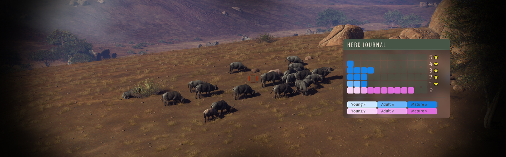
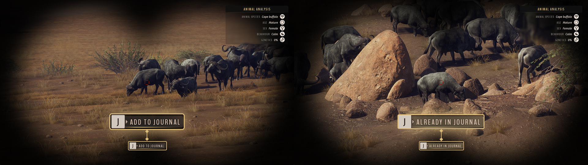
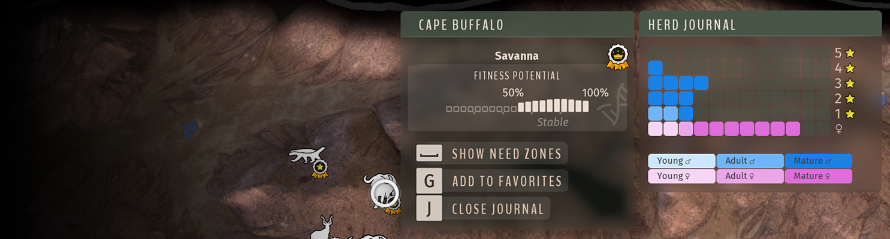
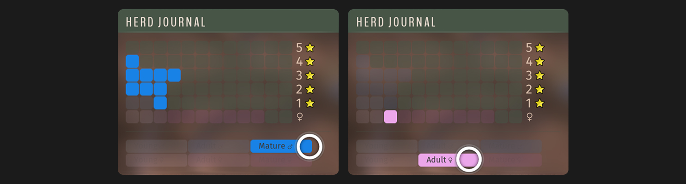

# Animal Journal — Way of the Hunter Mod

By Mahpella

Record individual animals through binoculars in Way of the Hunter and review each herd in a persistent journal organized by sex, age and trophy rating.

## Overview

Remembering every animal in several herds becomes difficult over repeated hunts. A promising male can be forgotten, and an unfamiliar animal is easy to mistake for one you have already checked. Animal Journal keeps a record of the individuals you personally add through binoculars and presents each herd in a clear grid, without automatically revealing new arrivals.

## Download & Install

You can download the mod from my [Website](https://mahpella.com/games/way-of-the-hunter/mods/animal-journal) or [Nexus Mods](https://www.nexusmods.com/wayofthehunter/mods/34).

### Step 1. Create a backup (optional)

If you wish, copy the Saved folder to another location:  
**Win + R → %LOCALAPPDATA%\WayOfTheHunter**

### Step 2. Open the game folder

Close the game. In Steam, browse the local files for Way of the Hunter and open:  
**WayOfTheHunter\Content\Paks**

### Step 3. Install the mod

Extract the archive and copy all **.pak files into the Paks folder**, replacing older versions if necessary.  
Launch the game and load your save.

## How to Use

- Observe an animal **through binoculars** and **hold J for 1.5 seconds to add it**. Females must also be added manually.

- Open a herd’s map card and **press J** or click its journal action.
- Review males by **trophy rating** and females in the final row; within each row, younger animals appear first.

- Hover over a category in the color legend to highlight the corresponding animals.
- Scroll the mouse wheel over the journal to change pages when any row has more than twelve entries.
- Press J, click the close action or press Esc to close the journal. Clicking outside both panels closes the journal and herd card.

> Revisit recorded animals to refresh available information. New arrivals are not added automatically!

## Feedback

If you find a bug, have suggestions for improving this mod, or have ideas for new mods, I would love to hear from you.

More useful interface and UX mods at my website: [https://mahpella.com](https://mahpella.com)

If you would like to support my work →  
[Buy Me a Coffee](https://buymeacoffee.com/mahpella) or [PayPal.me](https://paypal.me/bymahpella)

